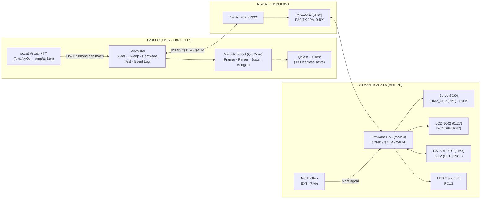

# STM32 Mini-SCADA — Servo & RTC Host (`ServoHMI`)

Hệ thống **Mini-SCADA** gồm firmware nhúng trên **STM32F103C8T6 (Blue Pill)** và ứng dụng giám sát desktop **Qt6 (C++17)** trên Linux, giao tiếp hai chiều theo thời gian thực qua chuẩn **UART / RS232 (`115200 8N1`)**. Dự án tập trung vào **cơ chế khóa an toàn E-Stop hai đầu**, **kiến trúc tách lớp kiểm thử tự động (`QtTest` + `CTest`)**, và **bộ công cụ chẩn đoán phần cứng trực tiếp**.

## Kiến trúc hệ thống



## Tính năng chính

### 1. Firmware STM32 (`firmware/stm32_SCADA_w1/`)
- **Điều khiển Servo PWM (`TIM2_CH2` · `PA1`):** Chu kỳ `20 ms` (`50 Hz`), ánh xạ `0°–180°` sang độ rộng xung `500–2500 µs`.
- **Khóa an toàn E-Stop cứng (`PA0` EXTI):** Chống dội `200 ms`, thu Servo ngay lập tức về `0°`, đóng băng màn hình LCD tại thời điểm sự cố, phát `$ALM:<HHMMSS>:BTN:PRESSED` và từ chối mọi `$CMD:SRV` cho tới khi nhận `$CMD:SYS:UNLOCK`.
- **Hiển thị & Thời gian thực (`I2C1` + `I2C2`):** Tách LCD 1602 (`I2C1`) và DS1307 RTC (`I2C2`), xoay vòng 2 trang giờ Việt Nam (GMT+7) và tổng thời gian Servo hoạt động.
- **Nhận UART bằng ngắt:** `HAL_UART_Receive_IT` từng byte không chặn siêu vòng lặp `while(1)`; phát `$ALM:...:SYS:BOOT` khi khởi động.

### 2. Ứng dụng Desktop Qt6 `ServoHMI` (`host-qt/`)
- **Tách lớp `ServoProtocol` (`Qt::Core` only):** `SerialLineFramer` (đóng khung `\n`/`\r\n`, chặn tràn `512` bytes), `parseProtocolLine()`, `HmiSessionState`, và `HardwareBringUpTracker` tách khỏi widget GUI và phủ **13 ca unit test tự động** (`CTest`).
- **Xử lý Serial bất đồng bộ:** Dùng `readyRead` và `errorOccurred` (tự đóng cổng, dừng Sweep/Bring-Up và khôi phục UI khi rút cáp USB nóng), không dùng vòng lặp chặn giao diện.
- **4 màn hình vận hành:**
  - **Manual Slider:** Thanh trượt, SpinBox và Preset (`0/45/90/135/180°`) với bộ tiết lưu `40 ms`.
  - **Auto Sweep:** Quét góc liên tục cấu hình Min/Max/Step/Interval (`>= 45 ms`), tự dừng khi chuyển tab hoặc gặp E-Stop.
  - **Hardware Test:** Kiểm tra LED `PC13`, góc nhanh, Self-Test `0→90→180→0`, console gửi lệnh ASCII thô, đo độ trễ vòng lặp **`RTT (ms)`**, và **Bring-Up Checklist 4 bước (`PASS/FAIL`)** theo phản hồi thật.
  - **Event Log:** Hiển thị lưu lượng TX/RX/Alarm theo thời gian thực và ghi audit trail theo ngày ra `logs/scada_YYYY-MM-DD.log`.

## Hướng dẫn Build, Test & Chạy

### 1. Pre-flight check môi trường (Fedora / Linux)
```bash
./scripts/check-env.sh
```
*(Tùy chọn gắn symlink cố định `/dev/scada_rs232`: xem hướng dẫn trong [scripts/99-scada-rs232.rules](scripts/99-scada-rs232.rules).)*

### 2. Build Qt HMI & chạy Unit Tests (`host-qt/`)
```bash
cmake -S host-qt -B host-qt/build-ninja -G Ninja
cmake --build host-qt/build-ninja
ctest --test-dir host-qt/build-ninja --output-on-failure
```

### 3. Build & nạp Firmware STM32 (`firmware/stm32_SCADA_w1/`)
- Mở project `firmware/stm32_SCADA_w1` trong **STM32CubeIDE** để build `.elf`, hoặc nạp qua CLI bằng ST-Link:
```bash
STM32_Programmer_CLI -c port=SWD -w firmware/stm32_SCADA_w1/Debug/stm32_SCADA_w1.elf -v -rst
```

### 4. Chạy `ServoHMI` & Test ảo không cần mạch (`socat`)
```bash
# Chạy với phần cứng thật (chọn /dev/scada_rs232 hoặc /dev/ttyUSB0)
./host-qt/build-ninja/ServoHMI

# Hoặc tạo cặp cổng ảo bằng socat để giả lập giao tiếp
socat -d -d pty,raw,echo=0,link=/tmp/ttyQt pty,raw,echo=0,link=/tmp/ttyStm
```

## Cấu trúc Repository

```text
mini-scada-stm32/
├── .github/workflows/ci.yml   # CI: Build Qt + CTest + ARM syntax check + ShellCheck
├── firmware/stm32_SCADA_w1/   # Project STM32CubeIDE (STM32F103C8Tx HAL)
├── host-qt/                   # Ứng dụng Qt6 C++17 (ServoProtocol + ServoHMI + tests/)
├── hardware/                  # Bằng chứng phần cứng (schematic, ảnh mạch, PulseView)
├── scripts/                   # check-env.sh, sync-rtc.py, sweep_servo.py, udev rule
└── docs/                      # wiring.md, protocol.md, so-tien-bo.md
```

## Tài liệu chi tiết
- [Sơ đồ chân & Nguồn phần cứng](docs/wiring.md)
- [Đặc tả giao thức `$CMD` / `$TLM` / `$ALM`](docs/protocol.md)
- [Sổ tiến bộ & Nhật ký sửa lỗi](docs/so-tien-bo.md)
