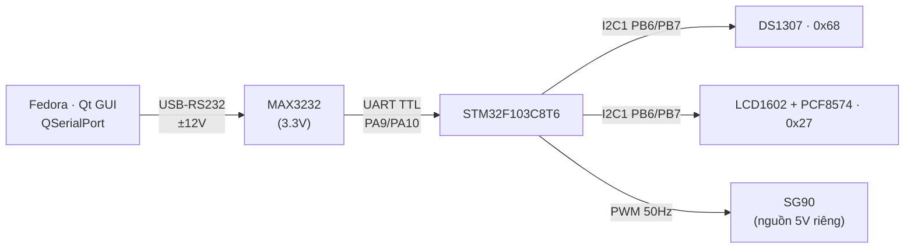

# STM32 RTC–Servo Host

Hệ thống STM32F103 đọc thời gian thực từ DS1307, hiển thị lên LCD 1602 (I2C), điều khiển servo SG90 bằng PWM, giao tiếp với ứng dụng Qt trên Fedora qua RS232 (MAX3232) bằng giao thức gói tin có CRC.



## Tiến độ

| Chặng | Thời gian | Trạng thái |
|---|---|---|
| Tuần 0 · Setup | 30/10 – 01/11/2026 | 🟡 Đang làm |
| 1 · I2C multi-slave | 02 – 15/11 | ⬜ |
| 2 · PWM Servo + nguồn | 16 – 29/11 | ⬜ |
| 3 · RS232 + Packet | 30/11 – 13/12 | ⬜ |
| Ôn thi | 14 – 31/12 | ⬜ |
| 4 · Qt GUI MVP | 01 – 13/01/2027 | ⬜ |

### Tuần 0 · Checklist
- [ ] Đặt mua logic analyzer 24MHz 8 kênh + dây jumper cái–cái
- [ ] `sudo dnf install openocd sigrok-cli pulseview ShellCheck`
- [ ] Chạy `scripts/check-env.sh` → không còn dòng ❌
- [ ] Loopback DB9 (nối tắt chân 2–3) → `picocom /dev/ttyUSB0 -b 115200` thấy ký tự dội lại
- [ ] Cấu hình git: `git config --global user.name "..."` + `user.email`, tạo repo trên GitHub, push commit đầu
- [ ] Blink LED PC13, nạp bằng **CLI** (không bấm nút Run trong IDE)
- [ ] Ghi dòng đầu tiên vào [Sổ tiến bộ](docs/so-tien-bo.md)

## Tài liệu
- [Lộ trình đầy đủ](docs/lo-trinh.md)
- [Sơ đồ chân](docs/wiring.md)
- [Đặc tả giao thức](docs/protocol.md) *(viết ở Chặng 3)*
- [Sổ tiến bộ & Nhật ký năng lượng](docs/so-tien-bo.md)

## Cấu trúc
```
firmware/   Project STM32CubeIDE
host-qt/    Ứng dụng Qt (Chặng 4)
scripts/    Tự động hóa: kiểm tra môi trường, build, flash, log serial
hardware/   Schematic KiCad, ảnh mạch, ảnh PulseView
docs/       Lộ trình, sơ đồ chân, giao thức, sổ tiến bộ
```
